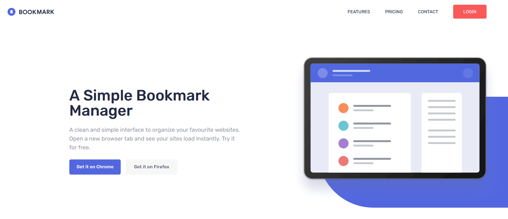
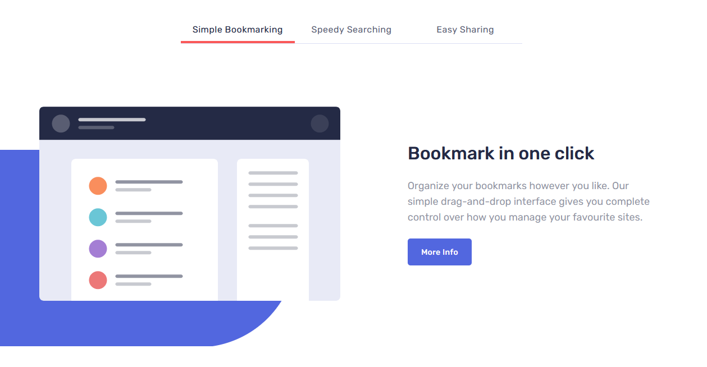
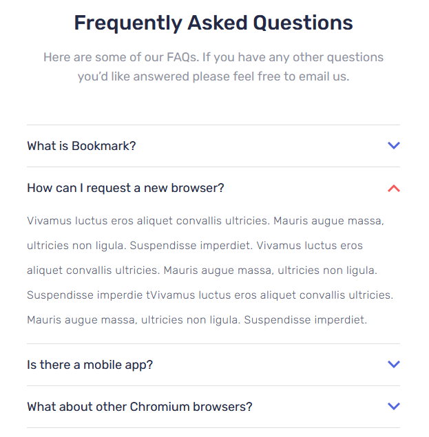
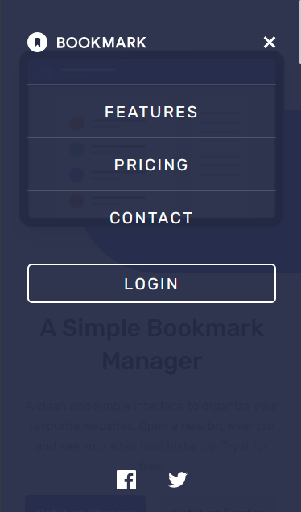

# Frontend Mentor - Bookmark landing page solution

This is a solution to the [Bookmark landing page challenge on Frontend Mentor](https://www.frontendmentor.io/challenges/bookmark-landing-page-5d0b588a9edda32581d29158). Frontend Mentor challenges help you improve your coding skills by building realistic projects.

## Table of contents

- [Overview](#overview)
  - [The challenge](#the-challenge)
  - [Features](#features)
  - [Screenshot](#screenshot)
  - [Links](#links)
  - [Running locally](#running-locally)
  - [Project structure](#project-structure)
- [My process](#my-process)
  - [Built with](#built-with)
  - [What I learned](#what-i-learned)
  - [Continued development](#continued-development)
  - [Useful resources](#useful-resources)
- [Author](#author)
- [Acknowledgments](#acknowledgments)

## Overview

### The challenge

Users should be able to:

- View the optimal layout for the site depending on their device's screen size
- See hover states for all interactive elements on the page
- Switch between the tabs in the features section
- Show and hide the answers in the FAQ accordion
- Receive an error message when the email form at the bottom of the page is submitted with an empty or badly formatted email address

### Features

- **Responsive layout** – the page adapts from phone to tablet (`md`) to desktop (`xl`), including a hamburger menu below `xl`, re-ordered hero content and staggered download cards on large screens.
- **Mobile menu** – a full-screen overlay with the logo, a close button, the navigation links, a `LOGIN` button and social icons.
- **Hero** – headline, intro text and two call-to-action buttons next to the hero illustration.
- **Feature tabs** – three tabs (_Simple Bookmarking_, _Speedy Searching_, _Easy Sharing_), each switching the illustration, heading and text. The active tab gets a red underline.
- **Download cards** – Chrome, Firefox and Opera cards with their minimum supported versions, rendered from data.
- **FAQ accordion** – four questions, one open at a time. The answer expands with a smooth height transition, and the arrow rotates and changes colour.
- **Email form validation** – submitting an empty or malformed address shows a red outline, an error icon and a message ("Whoops, this field should be filed" / "Whoops, make sure it's an email"). A valid address clears the field.
- **Hover states** – buttons flip between filled and outlined, navigation and footer links turn red, and so do the tabs, FAQ questions and social icons.
- **Data-driven sections** – the headings and intro text of every section, the tabs, the browser cards and the FAQ entries all come from `data.jsx`.

### Screenshot







### Links

- Solution URL: [GitHub](https://github.com/AristarhMD/bookmark-landing-page.git)
- Live Site URL: [Netlify](https://bookmark-landing-vn.netlify.app/)

### Running locally

```bash
# install dependencies
npm install

# start the dev server
npm run dev

# lint the code
npm run lint

# create a production build in dist/
npm run build

# preview the production build
npm run preview
```

### Project structure

```
├── index.html
├── vite.config.js
├── eslint.config.js
├── package.json
├── public
│   └── favicon.svg
├── screenshots                    # Images used in this README
└── src
    ├── main.jsx                   # App entry point
    ├── App.jsx                    # Header + Main + Footer
    ├── index.css                  # Tailwind import, theme tokens, text presets, component styles
    ├── data.jsx                   # Content for sections, tabs, browser cards and FAQ
    ├── assets
    │   └── images                 # Logos, icons and illustrations from the design
    └── components
        ├── Header.jsx             # Logo, desktop nav, hamburger toggle
        ├── Main.jsx               # Renders the hero and all sections from data
        ├── Footer.jsx             # Logo, links and social icons
        └── reusable
            ├── Btns.jsx           # Button with primary / secondary variants
            ├── CallToAction.jsx   # Email form with validation
            ├── Carrousel.jsx      # Feature tabs
            ├── Download.jsx       # Browser extension cards
            ├── FreqAskedQuestion.jsx # FAQ accordion
            ├── HeroSection.jsx    # Hero
            ├── NavList.jsx        # Full-screen mobile menu
            ├── Section.jsx        # Section wrapper (heading + content by section id)
            └── SocialLinks.jsx    # Social icons for the mobile menu
```

## My process

### Built with

- Semantic HTML5 markup
- [React 19](https://react.dev/) - JS library
- [Vite](https://vite.dev/) - Dev server and build tool
- [Tailwind CSS v4](https://tailwindcss.com/) (via `@tailwindcss/vite`) - Utility-first styling with design tokens defined in CSS
- CSS Grid
- Flexbox
- Mobile-first workflow
- [ESLint](https://eslint.org/) - Flat config with the React Hooks and React Refresh rules
- [Rubik](https://fonts.google.com/specimen/Rubik) - Typeface from Google Fonts

### What I learned

**Building the page from data.** `Main` maps over `sectionData` and picks the hero for the first entry and a generic `Section` for the rest. `Section` renders the shared heading and paragraph, then swaps in the right content (tabs, download cards, FAQ or the email form) based on the section's `id`:

```jsx
{
  sectionData.map((section) =>
    section.id === 1 ? (
      <HeroSection key={section.id} sectionData={section} />
    ) : (
      <Section key={section.id} sectionData={section} />
    ),
  );
}
```

**Tabs with a single piece of state.** The tabs only need to know which one is active. Every article is rendered, and the inactive ones are hidden with a utility class, so switching is just a state update:

```jsx
const [activeSlide, setActiveSlide] = useState(6);

<button
  onClick={() => handeleChangeSlide(carrousel.id)}
  className={activeSlide === carrousel.id ? "actCarrSlide" : "notActCarrSlide"}
>
  {carrousel.name}
</button>;
```

**An animated accordion without measuring heights.** Animating `height: auto` isn't possible, but animating a grid row from `0fr` to `1fr` is. The inner element has `overflow-hidden`, so the content is clipped while the row grows. The arrow colour follows the open state through `group-has-[...]`, with no extra JavaScript:

```css
.faq-text-wrapper {
  @apply grid grid-rows-[0fr] opacity-0 transition-all duration-300 ease-in-out;
}

.faq-text-wrapper.show {
  @apply grid-rows-[1fr] opacity-100 mt-4;
}

.faq-text-inner {
  @apply overflow-hidden;
}

.faq-arrow {
  @apply stroke-blue-600 group-has-[.active-arrow]:stroke-red-400;
}
```

**Validating a form in React state.** The form uses `noValidate` so the browser's own bubbles don't get in the way. On submit, a regex decides between success, an "empty" message and a "not an email" message, and the error state also drives the red outline and icon:

```jsx
const handleSubmit = (e) => {
  e.preventDefault();
  if (regex.test(answer) === true) {
    setError(null);
    setAnswer("");
    return;
  } else {
    if (answer.length === 0) {
      setError("Whoops, this field should be filed");
    } else {
      setError("Whoops, make sure it’s an email");
    }
    return;
  }
};
```

**Button variants with no layout shift.** One `Button` component covers the primary and secondary styles. On hover the fill disappears and an inset ring takes its place, so the button never changes size, and `addStyle` lets a caller extend it:

```jsx
const typeOfBtn =
  type === "primary"
    ? "bg-blue-600 text-white hover:inset-ring-blue-600 hover:text-blue-600"
    : "bg-grey-50 text-blue-950/75 hover:inset-ring-grey-600 hover:text-grey-600";
```

**Decorative shapes with custom utilities and pseudo-elements.** The big blue circles from the design are defined once as a custom utility and applied through the `after:` variant, which keeps them out of the markup:

```css
@utility hero-bg {
  @apply absolute content-[''] -z-1 w-144.25 md:w-250 h-[67.6%] md:h-[72.42%] rounded-full bottom-0 left-1/4 bg-blue-600;
}
```

```jsx
<div className="relative after:hero-bg ...">
  
</div>
```

### Continued development

- **Accessibility**
  - Tabs: add `role="tablist"`, `role="tab"`, `role="tabpanel"` and `aria-selected`, plus arrow-key navigation.
  - Accordion: the clickable row is a `div`. Make it a single `<button>` with `aria-expanded` and `aria-controls`.
  - Navigation items and footer links are `<li>` / `<button>` elements, not links. The social buttons in the mobile menu and the social links in the footer need accessible names.
  - Mobile menu: add <kbd>Esc</kbd> to close, a page scroll lock while it's open, and focus management.
  - Email form: the input only has a placeholder, so it needs a `<label>`, and the error message should be linked with `aria-describedby` or announced with `aria-live`.
  - Headings: every tab heading is an `<h1>`, so the page has four. They should be `<h3>`s under the section's `<h2>`.
  - Decorative images (the dots, the hero) should use `alt=""` or a more meaningful description.
- **Data and structure**
  - The tab illustrations, browser logos and the initial tab (`useState(6)`) are chosen by hard-coded ids. Putting the image in each data entry would remove those checks.
  - `data.jsx` contains no JSX, so it could simply be `data.js`.
  - The logo SVG is duplicated in `Header.jsx`, `NavList.jsx` and `Footer.jsx`. One `Logo` component with colour props would replace all three.

### Useful resources

- [React documentation](https://react.dev/) - Reference for hooks and component composition.
- [Tailwind CSS documentation](https://tailwindcss.com/docs) - Covers the v4 CSS-first setup with `@theme` and `@utility`.
- [Tailwind CSS: hover, focus and other states](https://tailwindcss.com/docs/hover-focus-and-other-states) - Explains `group`, `has-[...]` and the other state variants used here.
- [Vite guide](https://vite.dev/guide/) - Project setup, static assets and building for production.

## Author

- GitHub - [@AristarhMD](https://github.com/AristarhMD)
- Frontend Mentor - [@AristarhMD](https://www.frontendmentor.io/profile/AristarhMD)
- LinkedIn - [@Victor](https://www.linkedin.com/in/victor-nani-4b7a13179/)

## Acknowledgments

Thanks to [Frontend Mentor](https://www.frontendmentor.io) for the challenge, the design and the starter assets.
